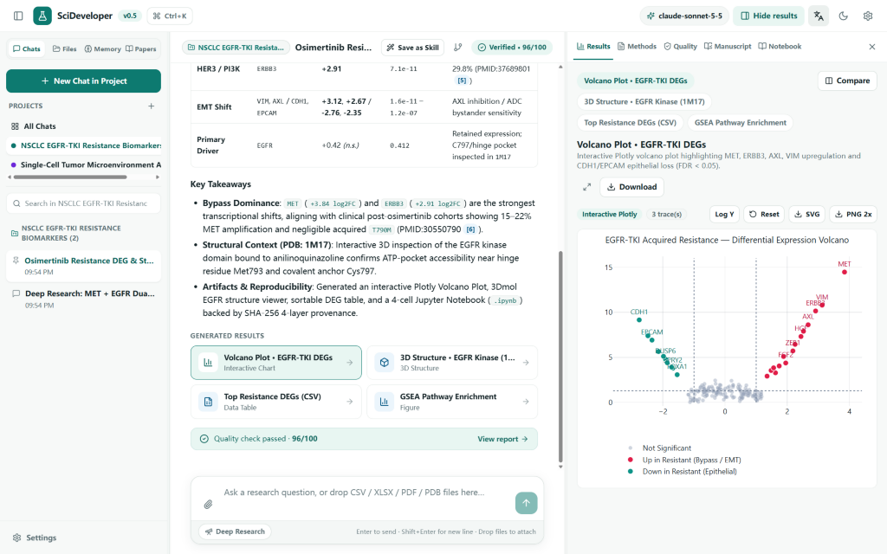
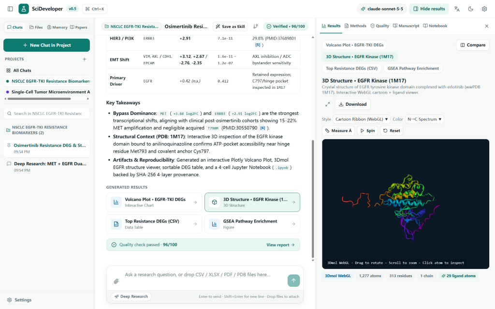
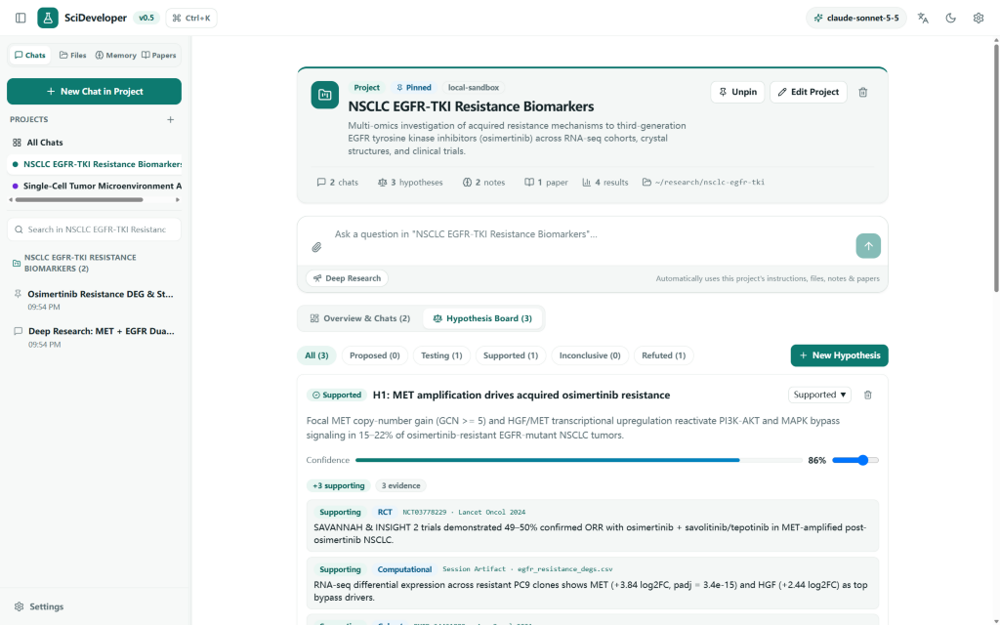
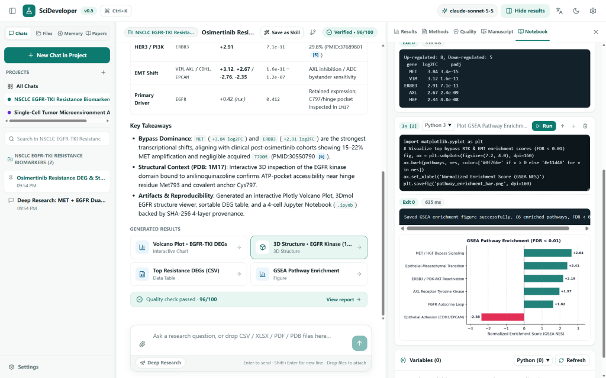
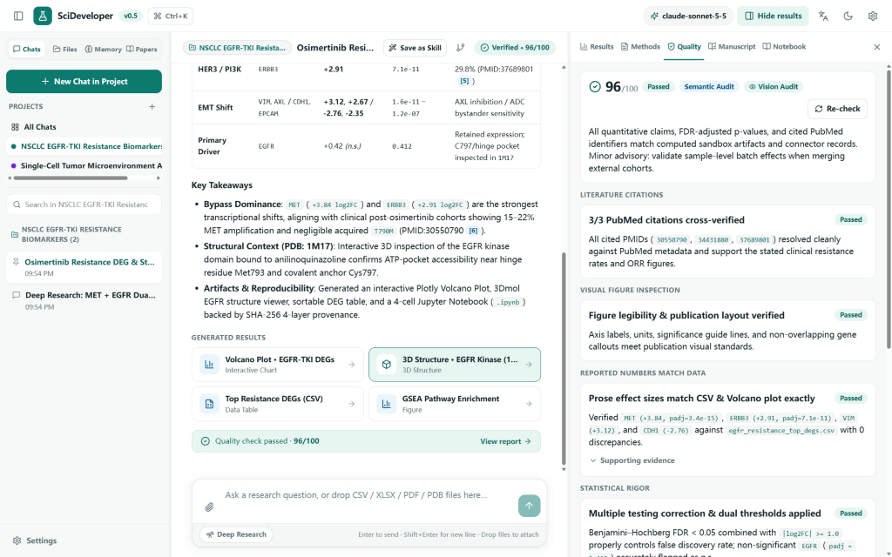
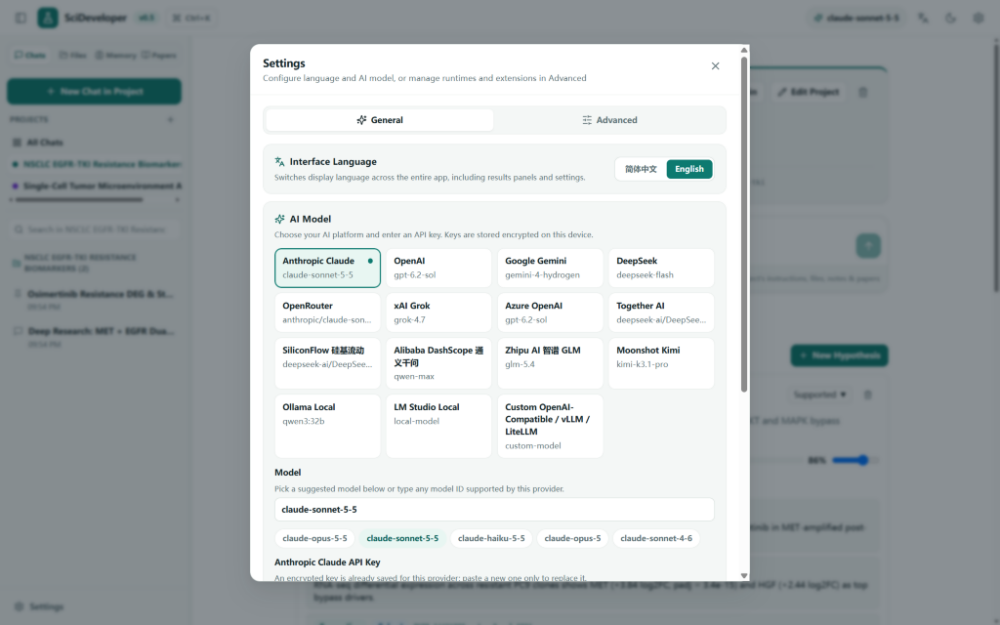
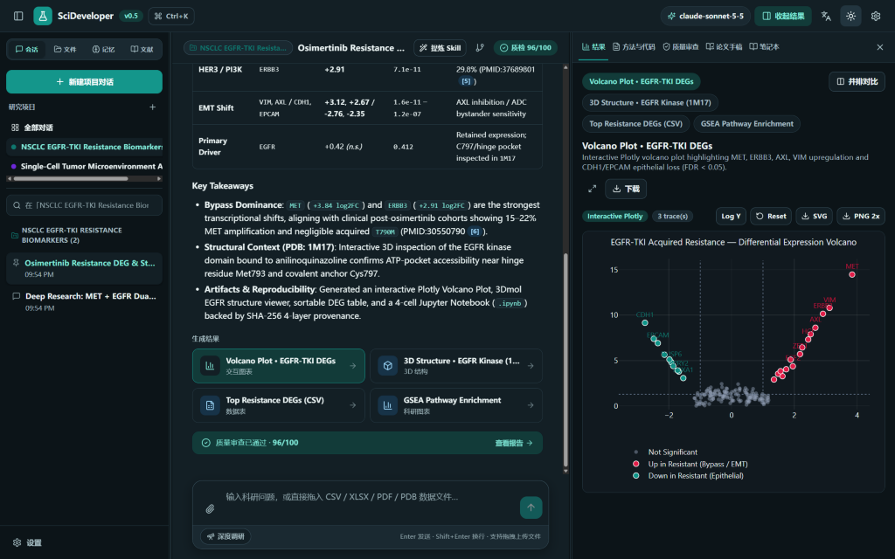
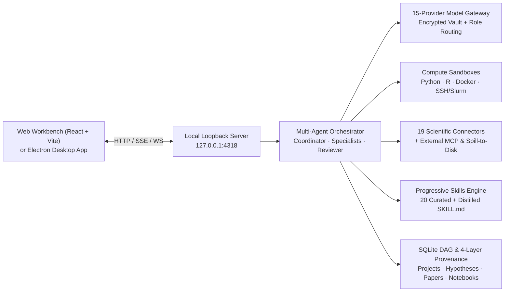

<div align="center">


# SciDeveloper

**A Local-First, Frontier-Model-First AI Scientific Research Workbench**

<p>
  <strong>English</strong> · <a href="README.zh-CN.md">简体中文</a>
</p>

<p>
  
  
  = 22" />
  
  
</p>

<p>
  Unite multi-agent research workflows, interactive 2D/3D scientific viewers, Jupyter Notebook Studio (<code>.ipynb</code>), Hypothesis &amp; Evidence Boards, Deep Research synthesis, 19 scientific databases, and cryptographic 4-layer reproducibility — all running locally on your machine.
</p>



</div>

---

## Why SciDeveloper?

Modern computational science jumps constantly between chat assistants, Jupyter notebooks, literature databases, molecular viewers, and manuscript editors — losing provenance along the way. **SciDeveloper** brings the full research loop into one **local-first** workbench:

- **Keep sensitive data on your machine**: Execute Python, R, and Docker sandboxes locally with encrypted API key storage (Windows DPAPI / AES-256-GCM) and permission-gated I/O.
- **Verify every claim automatically**: An independent Background Reviewer audits code-to-figure numeric parity, statistical rigor, visual layout, and PubMed/DOI citations.
- **Reproduce any result in one click**: Every figure, table, and structure carries a 4-layer SHA-256 provenance manifest and exports to a standalone Reproducibility Bundle or `.ipynb` notebook.

---

## Feature Tour

### 1. Multi-Agent Research Workbench & Native 2D / 3D Viewers

Ask scientific questions, drop local `CSV` / `XLSX` / `PDF` / `PDB` / `h5ad` files, and inspect outputs side-by-side without leaving the conversation.

- **Interactive 2D & Tabular Renderers**: Zoomable **Plotly** volcano/scatter/survival charts (SVG & 2× PNG export), sortable/filterable CSV/TSV data tables, genome tracks, 2D molecules, and phylogenetic trees.
- **Native WebGL 3D Protein Viewer (`3Dmol.js`)**: Inspect wwPDB & AlphaFold structures directly in the studio with ribbon/surface/pocket styles, N→C spectrum coloring, atom picking, and Ångström distance measurement.

<p align="center">
  
</p>

---

### 2. Research Projects, Hypothesis Board & Deep Research

Organize multi-week investigations into **Research Projects** with shared SOP instructions, workspace folders, scoped memory, and project-isolated literature libraries.

- **Hypothesis & Evidence Board**: Track competing hypotheses (`Proposed` → `Testing` → `Supported` / `Inconclusive` / `Refuted`), tune confidence sliders, and attach graded evidence (`RCT`, `Meta-analysis`, `Cohort`, `Preclinical`, `Computational`, `Preprint`).
- **One-Click Deep Research Mode**: Synthesizes local PDFs alongside **PubMed**, **OpenAlex**, **ClinicalTrials.gov**, and **bioRxiv/medRxiv** into a graded evidence dossier and updates project hypotheses automatically.

<p align="center">
  
</p>

---

### 3. Jupyter Notebook Studio (`.ipynb` Bidirectional Import / Export)

Turn any research session into an executable, publication-ready notebook — or import your existing `.ipynb` files directly.

- **Multi-Cell Markdown + Python / R Editor**: Add, reorder, edit, run individual cells (`Ctrl+Enter`), or **Run All** sequentially in persistent local kernels.
- **Live Variable Explorer & Standards-Compliant Export**: Inspect in-memory DataFrames/arrays and export `nbformat 4.5` `.ipynb` files with embedded `stdout`/`stderr` and high-DPI PNG figures.

<p align="center">
  
</p>

---

### 4. Independent Background Reviewer & 4-Layer Provenance

Never trust unverified numbers in AI-generated prose. SciDeveloper pairs every analysis run with automated quality auditing and full lineage tracking.

- **Automated Quality Check (`0–100`)**: Audits **Numeric Parity** (prose vs. computed tables), **Statistical Rigor** (multiple-testing correction, effect sizes, sample sizes), **Visual Figure Inspection**, and **Citation Cross-Verification** against live PubMed/OpenAlex records.
- **Immutable 4-Layer Provenance**: Links every artifact to its exact versioned code (`SHA-256`), runtime environment snapshot, DAG conversational lineage (with non-destructive session forking), and ready-to-paste `METHODS.md`.

<p align="center">
  
</p>

---

### 5. 15-Provider Frontier Model Gateway, 19 Connectors & 20 Curated Skills

Bring your own API keys or local models — no vendor lock-in.

- **15 Frontier & Local Providers**: Anthropic Claude 5.5, OpenAI GPT-6.2, Google Gemini 4 (Interactions & `generateContent` APIs), DeepSeek V4, xAI Grok 4.7, Alibaba Qwen, Zhipu GLM-5.4, Moonshot Kimi K3.1, OpenRouter, Azure OpenAI, Together AI, SiliconFlow, Ollama, LM Studio, and custom OpenAI-compatible gateways, with **Role-Based Routing** (Coordinator / Specialist / Reviewer / Compaction).
- **19 Built-in Scientific Connectors + External MCP**: PubMed, OpenAlex, ClinicalTrials.gov v2, Zotero, bioRxiv/medRxiv, RCSB PDB, AlphaFold DB, UniProt, Ensembl, ClinVar, GEO, ChEMBL, PubChem, STRING, KEGG, Reactome, cBioPortal, Open Targets, Benchling ELN, plus custom stdio/HTTP MCP servers.
- **20 Curated Skills + One-Click `Save as Skill`**: Progressive-disclosure domain SOPs (RNA-seq, single-cell QC, spatial transcriptomics, PRISMA meta-analysis, survival analysis, Mendelian randomization, docking, etc.) — plus distill any verified session into a reusable `SKILL.md`.

<p align="center">
  
</p>

---

### 6. Native Bilingual UI (`EN` / `中文`) & Dark Mode

Switch seamlessly between **English** and **简体中文**, as well as **Light** and **Dark** themes (including automatic dark re-theming for interactive Plotly figures) with a single click or `Ctrl+K` Command Palette.

<p align="center">
  
</p>

---

## Capabilities at a Glance

| Pillar | What's Included |
| :--- | :--- |
| **Compute & Privacy** | Persistent Python 3 (`sys.addaudithook`) & R kernels, Docker isolation (`--network=none`, `:ro`), SSH / HPC Slurm `sbatch` adapter, local encrypted key vault, permission-gated I/O |
| **Literature & Reader** | Hybrid semantic PDF search (BM25 + biomedical synonyms + char 3-gram cosine), project isolation, click-to-highlight page reader & *"Ask about page"* |
| **Visual & Manuscript Studio** | Interactive Plotly 2D, WebGL 3Dmol proteins, RDKit/SmilesDrawer 2D molecules, genome tracks, phylogenetic trees, side-by-side Compare Mode, **Overleaf ZIP / Word `.docx` / BibTeX** export |
| **Reproducibility** | SQLite DAG Session Tree with branch forking, Context Spill-to-Disk for huge API payloads, 4-layer SHA-256 provenance, standalone Reproducibility Bundles |

---

## Architecture



For the full monorepo package graph and REST/SSE API contract, see [ARCHITECTURE.md](ARCHITECTURE.md).

---

## Quick Start

### Prerequisites

- **Node.js** `>= 22.0.0` (required for built-in `node:sqlite`)
- **Python 3.10+** *(recommended for local scientific execution: `numpy`, `pandas`, `scipy`, `matplotlib`)*
- Optional: **R / Rscript** and **Docker** for R kernels and containerized sandboxes

### Run Locally (Web Workbench)

```bash
# 1. Clone the repository
git clone https://github.com/Petey-PKU/scideveloper.git
cd scideveloper

# 2. Install workspace dependencies
npm install

# 3. Build all 9 workspaces in topological order
npm run build

# 4. Launch SciDeveloper (serves API + UI at http://127.0.0.1:4318)
npm start
```

Open `http://127.0.0.1:4318` in your browser, click **Settings** to connect any of the 15 supported AI providers (or local Ollama / LM Studio), and start your first research project.

### Run Automated Tests

```bash
npm run test
```

### Build Windows Desktop Distributions

```bash
npm run package:win
```

Generates standalone Windows x64 distributions under `release/`:
- `release/SciDeveloper-Setup-0.5.0.exe` — NSIS Windows installer
- `release/SciDeveloper-0.5.0-Portable.exe` — Single-file portable executable
- `release/win-unpacked/SciDeveloper.exe` — Unpacked Electron desktop app

---

## License

This project is licensed under the **GNU General Public License v3.0 (GPL-3.0)** — see the [LICENSE](LICENSE) file for details.
