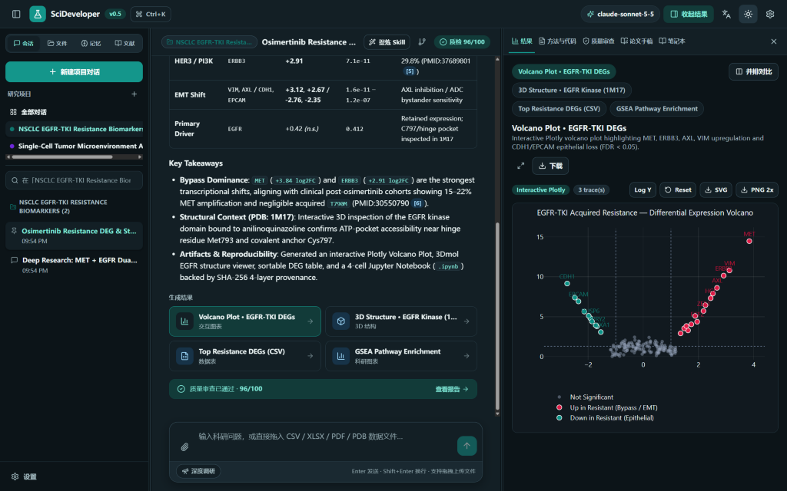
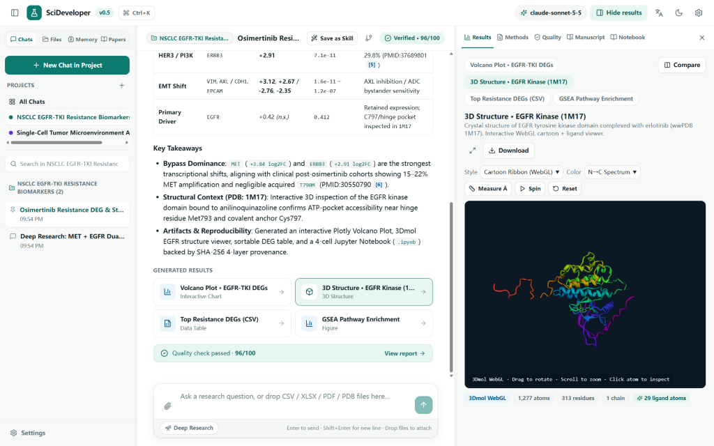
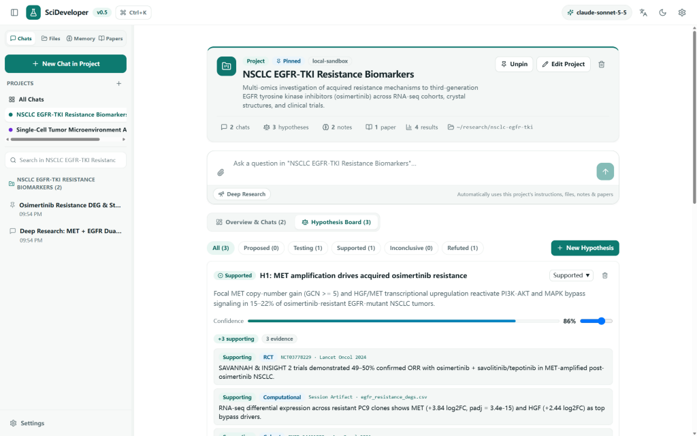
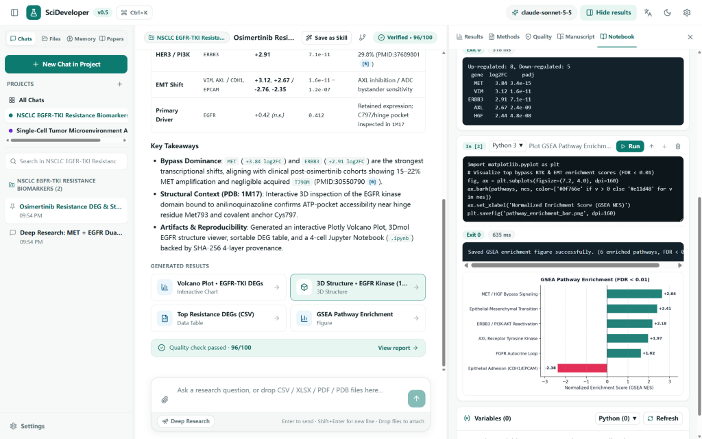
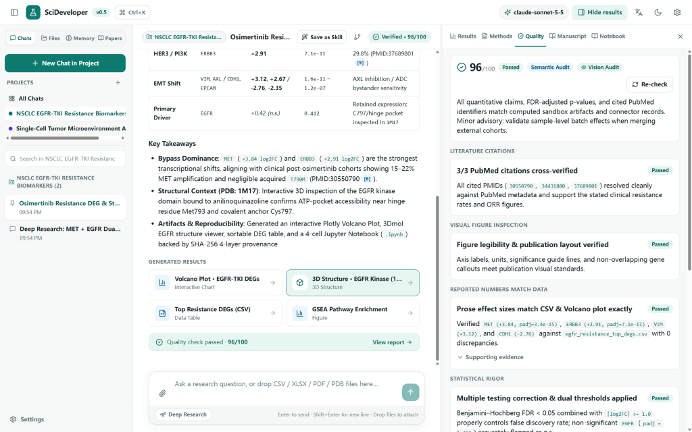
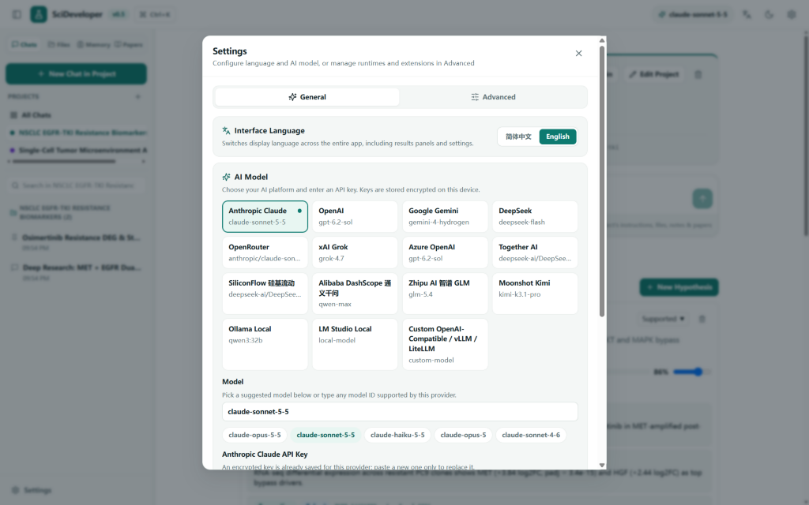
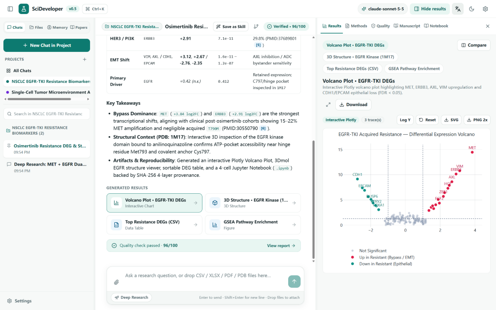
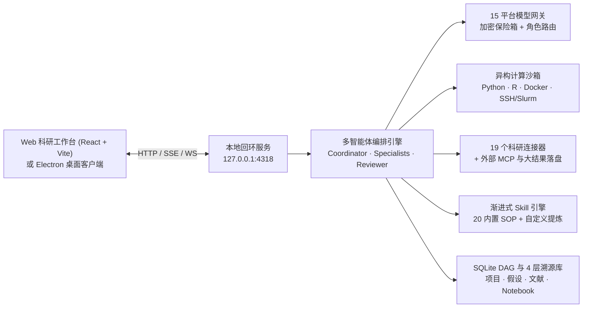

<div align="center">


# SciDeveloper

**本地优先、前沿大模型驱动的 AI 科研工作台**

<p>
  <a href="README.md">English</a> · <strong>简体中文</strong>
</p>

<p>
  
  
  = 22" />
  
  
</p>

<p>
  将多智能体科研协作、2D/3D 交互式科学可视化、Jupyter Notebook 工作室（<code>.ipynb</code> 双向导入导出）、课题假设与证据看板、多源 Deep Research 深度调研、19 个科研数据库连接器与 4 层可复现溯源整合进同一个本地工作台。
</p>



</div>

---

## 为什么选择 SciDeveloper？

日常科研分析往往要在聊天工具、Jupyter、文献库、蛋白结构浏览器和论文编辑器之间来回切换，数据分散且难以复现。**SciDeveloper** 将完整科研闭环沉淀到一个**本地优先（Local-First）**的工作台中：

- **原始数据不出本机**：在本地 Python / R / Docker 沙箱中执行分析，API 密钥通过本机加密保险箱保存（Windows DPAPI / AES-256-GCM），所有敏感读写操作均受权限策略管控。
- **分析结论自动质检**：独立的后台审查智能体（Background Reviewer）自动核验文本数值与计算结果一致性、统计学严谨性、图表排版以及 PubMed/DOI 文献真实性。
- **一键完整复现**：每个图表、数据表和结构产物都绑定 4 层 SHA-256 溯源清单，支持一键导出独立可复现包（Reproducibility Bundle）或标准 `.ipynb` 笔记本。

---

## 核心功能一览

### 1. 多智能体科研工作台与原生 2D / 3D 科学可视化

直接拖入本地 `CSV` / `XLSX` / `PDF` / `PDB` / `h5ad` 数据文件即可开展分析，在三栏式工作台内边对话边交互查看结果。

- **交互式 2D 图表与数据表**：内置 **Plotly** 火山图/散点图/生存曲线（支持缩放、悬浮查看与 SVG / 2× PNG 导出）、可排序筛选的 CSV/TSV 数据表、基因组轨道图、2D 分子结构与系统发育树。
- **原生 WebGL 3D 蛋白结构浏览器（`3Dmol.js`）**：无需切换外部软件即可旋转缩放 wwPDB 与 AlphaFold 3D 结构，支持飘带/表面/口袋渲染模式、光谱着色、原子拾取及 Å 级距离测量。

<p align="center">
  
</p>

---

### 2. 科研项目空间、假设证据看板与 Deep Research 深度调研

按课题创建独立的 **Research Project（科研项目）**，共享项目 SOP 指令、本地工作区文件夹、项目级科研记忆与文献库。

- **假设与证据看板（Hypothesis Board）**：追踪竞争假设状态（`Proposed` / `Testing` / `Supported` / `Inconclusive` / `Refuted`），动态调节置信度，并挂载分级证据（`RCT`、`Meta-analysis`、`Cohort`、`Preclinical`、`Computational`、`Preprint`）。
- **一键 Deep Research 深度调研**：并行检索项目本地 PDF、**PubMed**、**OpenAlex**、**ClinicalTrials.gov** 与 **bioRxiv/medRxiv**，自动生成分级证据矩阵与共识/冲突审计，并回写更新假设看板。

<p align="center">
  
</p>

---

### 3. Jupyter Notebook 工作室（`.ipynb` 双向导入导出）

一键将任意科研对话整理为结构化多单元格 Notebook，或直接导入已有的 `.ipynb` 文件继续迭代。

- **多单元格 Markdown + Python / R 编辑与执行**：支持增删排序单元格、单格运行（`Ctrl+Enter`）或 **Run All** 顺序执行，复用持久化本地内核并实时展示输出。
- **变量浏览器与标准导出**：实时查看内存中的 DataFrame/数组变量，并导出符合 `nbformat 4.5` 规范的 `.ipynb` 文件（完整保留 `stdout`/`stderr` 与高清 PNG 图表）。

<p align="center">
  
</p>

---

### 4. 独立后台质量审查与 4 层可复现溯源

避免大模型在科研写作中“编造引用”或“正文与图表数值对不上”，SciDeveloper 内置双层质量保障：

- **自动化质量审查（`0–100` 评分）**：涵盖 **文献引用核验**、**报告数值与数据表一致性**、**统计学严谨性**（多重检验校正、效应量、样本量）、**图表视觉排版检查** 以及 **可复现记录完整性**。
- **4 层不可变溯源清单**：自动记录每个产物的精确代码与 `SHA-256` 校验、运行环境快照、DAG 会话血缘（支持任意历史节点无损分叉 Fork）以及可直接用于论文的 `METHODS.md`。

<p align="center">
  
</p>

---

### 5. 15 平台前沿模型网关、19 个科研连接器与 20 项精选 Skill

自带 API Key 或连接本地大模型，自由切换、无平台锁定。

- **15 个国内外前沿与本地模型平台**：原生接入 Anthropic Claude 5.5、OpenAI GPT-6.2、Google Gemini 4（支持 Interactions 与 `generateContent` API）、DeepSeek V4、xAI Grok 4.7、阿里通义千问 DashScope、智谱 GLM-5.4、月之暗面 Kimi K3.1、OpenRouter、Azure OpenAI、Together AI、硅基流动 SiliconFlow、Ollama、LM Studio 及自定义 OpenAI 兼容网关，并支持按角色分配模型（主控 / 专家 / 审查 / 压缩）。
- **19 个内置科研连接器 + 外部 MCP**：覆盖 PubMed、OpenAlex、ClinicalTrials.gov v2、Zotero、bioRxiv/medRxiv、RCSB PDB、AlphaFold DB、UniProt、Ensembl、ClinVar、GEO、ChEMBL、PubChem、STRING、KEGG、Reactome、cBioPortal、Open Targets、Benchling ELN，并支持接入自定义 stdio/HTTP MCP 服务。
- **20 项渐进式科研 Skill + 一键提炼 Skill**：内置 RNA-seq、单细胞质控、空间转录组、PRISMA 荟萃分析、生存分析、孟德尔随机化、分子对接等标准 SOP，还可一键将验证通过的对话流程沉淀为可复用的本地 `SKILL.md`。

<p align="center">
  
</p>

---

### 6. 原生中英文双语与深浅色主题切换

顶栏一键或 `Ctrl+K` 命令面板即可在 **简体中文 / English** 与 **浅色 / 深色模式** 之间无缝切换，交互式 Plotly 图表也会随主题自动重新配色。

<p align="center">
  
</p>

---

## 能力矩阵

| 模块 | 核心能力 |
| :--- | :--- |
| **本地算力与安全** | 持久化 Python 3（`sys.addaudithook` 保护）与 R 内核、Docker 隔离沙箱（`--network=none`, `:ro`）、SSH / HPC Slurm `sbatch` 作业提交、本机加密密钥库、I/O 权限审批门控 |
| **文献库与高亮阅读** | 混合语义 PDF 检索（BM25 + 生物医学同义词扩展 + 字符 3-gram 余弦相似度）、项目级文献隔离、原文精准定位高亮阅读与一键「针对本页提问」 |
| **可视化与论文导出** | 交互式 Plotly 2D 图表、WebGL 3Dmol 蛋白视图、2D 分子结构、基因组轨道、系统发育树、并排对比模式，支持导出 **Overleaf ZIP / Word `.docx` / BibTeX** |
| **工程级可复现** | SQLite DAG 会话树与历史节点分叉、超长 API 结果自动落盘（Spill-to-Disk）、4 层 SHA-256 溯源清单、独立可复现包导出 |

---

## 系统架构



完整包依赖图与 REST / SSE 接口规范请参阅 [ARCHITECTURE.md](ARCHITECTURE.md)。

---

## 快速开始

### 环境要求

- **Node.js** `>= 22.0.0`（用于内置 `node:sqlite`）
- **Python 3.10+** *（推荐安装 `numpy`、`pandas`、`scipy`、`matplotlib` 以启用本地科学计算）*
- 可选：**R / Rscript** 与 **Docker**（用于 R 内核和容器化沙箱隔离）

### 本地启动（Web 工作台）

```bash
# 1. 克隆仓库
git clone https://github.com/Petey-PKU/scideveloper.git
cd scideveloper

# 2. 安装所有工作区依赖
npm install

# 3. 按依赖拓扑顺序构建全部 9 个工作区
npm run build

# 4. 启动 SciDeveloper（同时提供 API 与前端界面：http://127.0.0.1:4318）
npm start
```

在浏览器打开 `http://127.0.0.1:4318`，点击右上角 **设置** 配置任意 AI 模型平台（或本地 Ollama / LM Studio），即可开始使用。

### 运行自动化测试

```bash
npm run test
```

### 打包 Windows 桌面安装包

```bash
npm run package:win
```

会在 `release/` 目录下生成 3 种 Windows x64 桌面分发版：
- `release/SciDeveloper-Setup-0.5.0.exe` — NSIS 安装包（自动创建桌面与开始菜单快捷方式）
- `release/SciDeveloper-0.5.0-Portable.exe` — 单文件绿色便携版
- `release/win-unpacked/SciDeveloper.exe` — 免安装解压版桌面程序

---

## 开源协议

本项目基于 **GNU General Public License v3.0 (GPL-3.0)** 开源，详见 [LICENSE](LICENSE) 文件。
